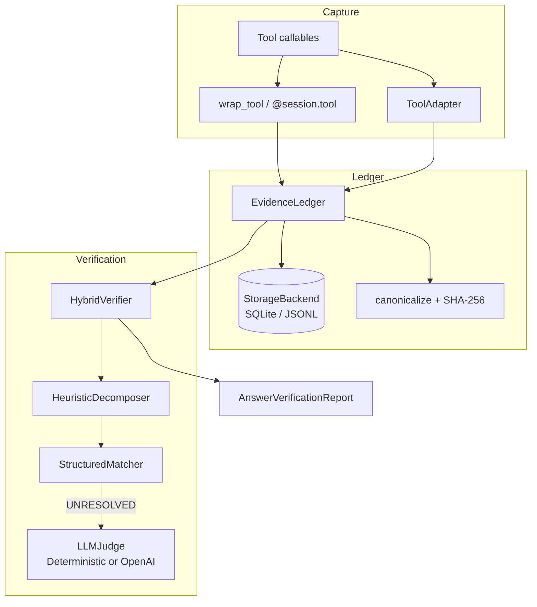
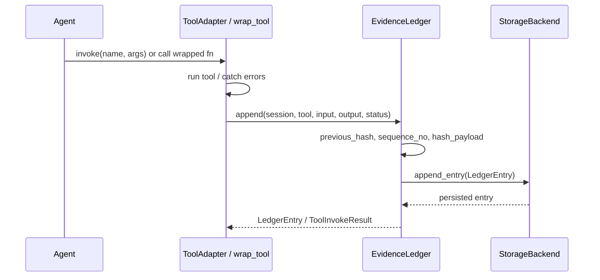
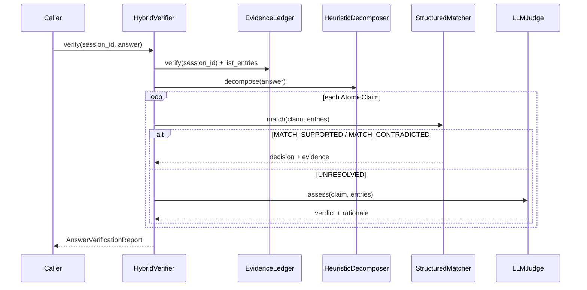

# Architecture (guide)

This page summarizes the **implemented** architecture. The normative design write-up is [architecture.md](architecture.md).

## Component map

## Runtime data flow

### Recording a tool call

### Verifying an answer

## Layers (code)

| Layer | Modules |
|-------|---------|
| Public API | `__init__.py`, `integration.py`, `verify.py` |
| Ledger | `ledger.py`, `hashing.py`, `canonicalize.py`, `models.py` |
| Storage | `storage.py` |
| Tools | `tools/adapter.py`, `tools/calculator.py`, `lookup_db.py`, `fake_weather.py` |
| Claims | `claims/decomposer.py`, `structured_matcher.py`, `derivations.py`, `llm_judge.py`, `verifier.py`, `taxonomy.py` |
| Evaluation | `evaluation/*` |
| Surfaces | `api.py`, `cli.py`, `api/index.py` |

## Design freezes reflected in code

- Hash algorithm: **SHA-256 only** (`hashing.py`).
- Genesis: literal string **`GENESIS_V1`**.
- Canonical JSON: sorted keys, no NaN/Inf (`canonicalize.py`).
- Matcher before judge; judge only on unresolved claims.
- No frontend; optional HTTP for deploy.
