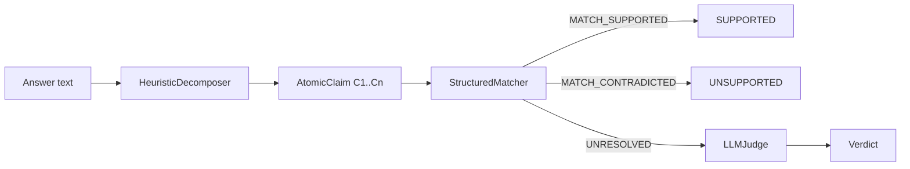

# Claim verification pipeline

Entry point: `HybridVerifier.verify(session_id, answer)` or `verify_answer(...)`.

## Pipeline

Chain integrity is checked first. If invalid, claims are marked with `PROCESSING_ERROR` / unsupported rationale and aggregate `INTEGRITY_FAILURE`.

## Decomposer

- Interface: `ClaimDecomposer.decompose(answer) -> list[AtomicClaim]`
- Default: `HeuristicDecomposer` — split on sentence boundaries `(?<=[.!?])\s+`, IDs `C1..Cn`
- Claim types via `infer_claim_type`: `direct_numeric`, `derived`, `paraphrased`, `other`

No LLM decomposer is shipped enabled by default; the ABC allows a future plug-in.

## Structured matcher

`StructuredMatcher.match(claim_text, entries)` flattens each entry’s `output_json` / `input_json` to leaf paths (`$.output...`, `$.input...`).

**Derived patterns** (when regex matches), using helpers in `derivations.py`:

| Pattern | Inputs used |
|---------|-------------|
| “increased/decreased/… by N%” | `old_value` / `new_value` fields → percentage change |
| “ratio … N” | numeric leaves → ratio |
| “sum … N” | numeric leaves → sum |
| “N days between” | `start_date` / `end_date` → day delta |

**Direct numeric:** claim numbers compared to numeric leaves within `numeric_tolerance` (default `1e-6`).

Decisions: `MATCH_SUPPORTED`, `MATCH_CONTRADICTED`, `UNRESOLVED`.

## LLM judge

Interface `LLMJudge.assess(claim_text, entries) -> JudgeResult`.

| Implementation | When |
|----------------|------|
| `DeterministicJudge` | Default / tests / no key — conservative stub |
| `OpenAIJudge` | `LLM_JUDGE_ENABLED` and `OPENAI_API_KEY` and `[openai]` installed |

`build_judge(...)` selects implementation. Tool outputs are treated as **untrusted data** in prompts (never as instructions).

Unresolved matcher results use method `llm_judge` even when the stub runs.

## Aggregate status

`AnswerVerificationReport.aggregate`:

| Status | Condition |
|--------|-----------|
| `INTEGRITY_FAILURE` | Chain not `VALID` |
| `NO_CLAIMS` | No atomic claims |
| `HAS_UNSUPPORTED` | Any `UNSUPPORTED` |
| `PARTIALLY_SUPPORTED` | Any `PARTIALLY_SUPPORTED` |
| `FULLY_SUPPORTED` | All `SUPPORTED` |
